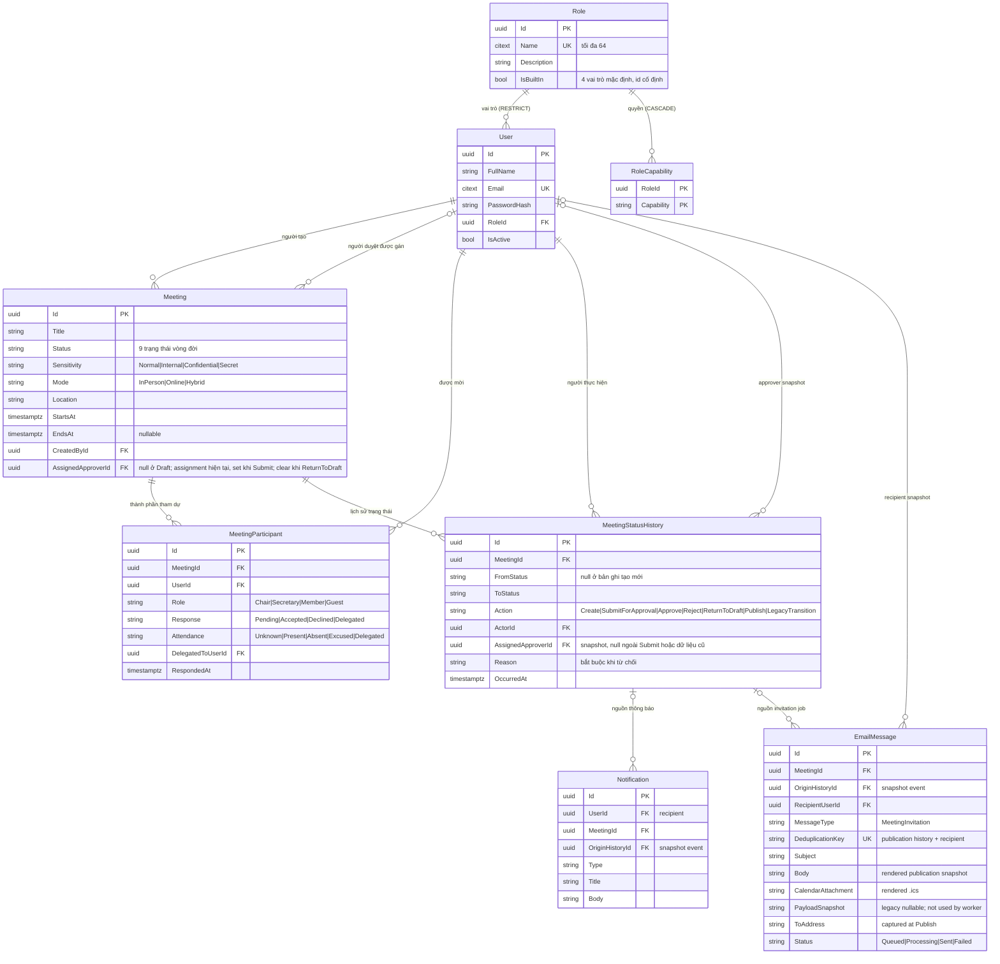
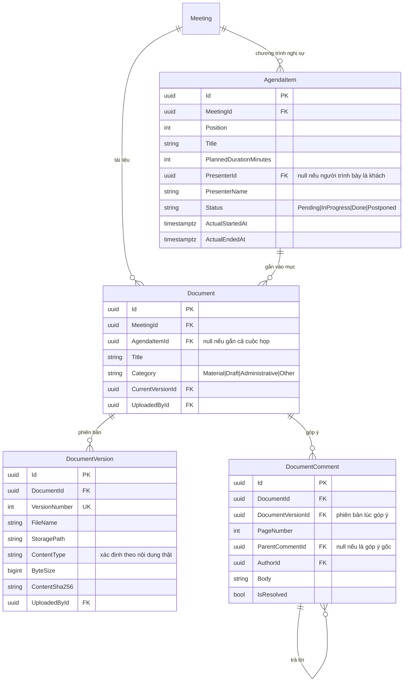
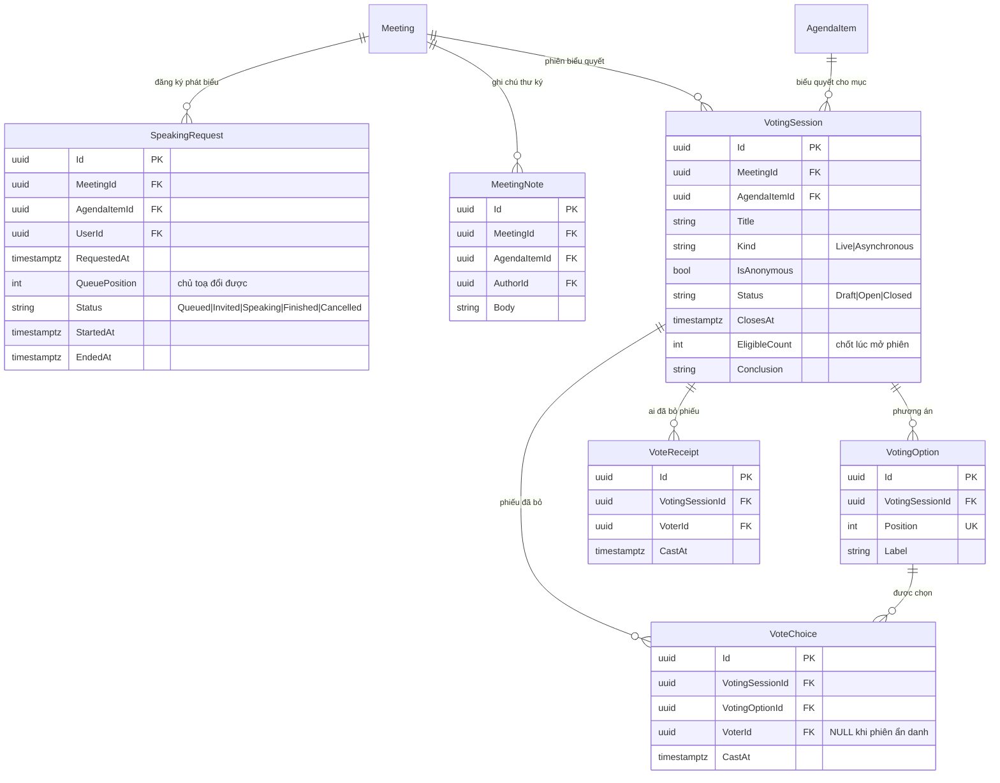
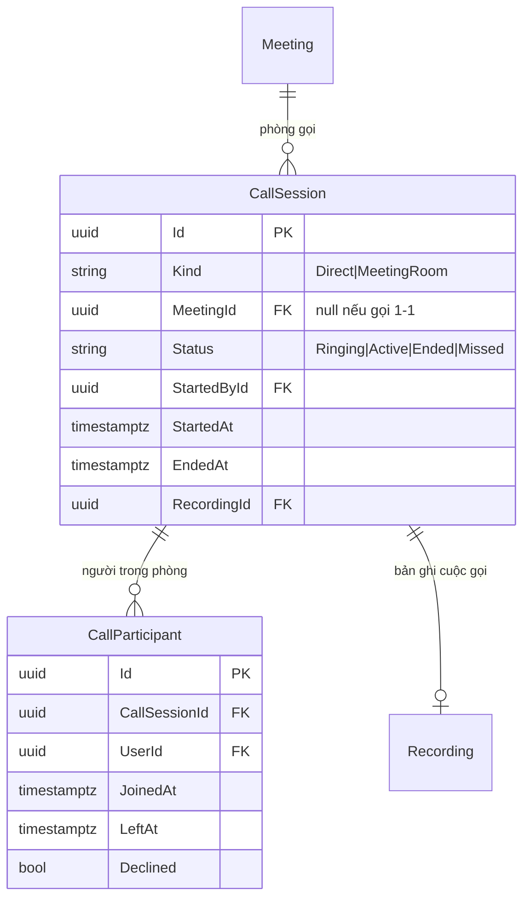

# Mô hình dữ liệu (ERD)

Toàn bộ mô hình dữ liệu của TrustCabinet, suy ra từ tiêu chí nghiệm thu của các story trong Jira.
**27 bảng.** Đây là tài liệu nguồn để vẽ Class Diagram (`SCRUM-55`) và ERD nộp (`SCRUM-56`), và để
BE biết mình đang làm việc với cái gì.

Hiện thực: EF Core 10 code-first, PostgreSQL qua Npgsql
([ADR-0003](../05-decisions/0003-chon-postgresql-thay-cho-sql-server.md)). Entity ở
[backend/TrustCabinet.Domain/Entities/](../../backend/TrustCabinet.Domain/Entities/), cấu hình bảng
ở [backend/TrustCabinet.Infrastructure/Configurations/](../../backend/TrustCabinet.Infrastructure/Configurations/).
Cách chạy: [03-co-so-du-lieu.md](03-co-so-du-lieu.md).

> **Mô hình này đi trước tài liệu BA, có chủ đích.** Nó được suy ra từ tiêu chí nghiệm thu đã viết
> trong Jira, chứ không phải từ Use Case Specification đã duyệt. Khi BA viết UC spec và vẽ Class
> Diagram, phải đối chiếu lại: chỗ nào lệch thì sửa **một trong hai**, có chủ ý, chứ đừng để hai
> tài liệu cùng tồn tại mà nói khác nhau.

## Bảng nào phục vụ story nào

| Nhóm | Bảng | Story |
|---|---|---|
| Truy cập | `users`, `roles`, `role_capabilities` | `SCRUM-11`, `SCRUM-12`, `SCRUM-13`, `SCRUM-60`, `SCRUM-63` |
| Cuộc họp | `meetings`, `meeting_status_history`, `meeting_participants` | `SCRUM-17`, `SCRUM-18`, `SCRUM-19`, `SCRUM-20`, `SCRUM-26` |
| Tài liệu | `documents`, `document_versions`, `document_comments` | `SCRUM-21`, `SCRUM-22`, `SCRUM-23` |
| Nghị sự | `agenda_items` | `SCRUM-25` |
| Trong phiên | `speaking_requests`, `meeting_notes` | `SCRUM-27`, `SCRUM-30` |
| Biểu quyết | `voting_sessions`, `voting_options`, `vote_receipts`, `vote_choices` | `SCRUM-24`, `SCRUM-28` |
| Bản ghi | `recordings`, `transcripts`, `transcript_segments` | `SCRUM-29`, `SCRUM-31`, `SCRUM-35`, `SCRUM-44` |
| Biên bản | `meeting_minutes`, `minutes_signatures`, `meeting_summaries` | `SCRUM-32`, `SCRUM-33`, `SCRUM-36`, `SCRUM-37` |
| Nền tảng | `notifications`, `email_messages`, `audit_log` | `SCRUM-14`, `SCRUM-15`, `SCRUM-16` |
| Gọi | `call_sessions`, `call_participants` | `SCRUM-39`, `SCRUM-40`, `SCRUM-41`, `SCRUM-44` |

`SCRUM-38` (báo cáo, thống kê) không sinh bảng mới — nó đọc lại những bảng trên.

## 1. Truy cập và cuộc họp



`MeetingStatusHistory` là append-only audit evidence: FK từ history tới Meeting dùng RESTRICT, EF
và PostgreSQL chặn sửa/xóa/truncate. Notification và invitation job của một transition giữ
`OriginHistoryId` để truy được batch tạo cùng lần commit.

`Response` và `Attendance` là **hai câu hỏi khác nhau**: một là người ta trả lời thư mời thế nào,
hai là thực tế có mặt hay không. Nhận lời rồi không đến là chuyện bình thường, và số liệu quorum
tính trên `Attendance`.

## 2. Nghị sự và tài liệu



File không bao giờ bị ghi đè: tải bản mới là thêm một `DocumentVersion`. Góp ý trỏ vào **phiên bản
lúc viết**, vì câu nó nhắc tới có thể không còn ở bản sau.

> **`Document.MeetingId` không phải bất biến — sẽ bỏ.**
> [ADR-0006](../05-decisions/0006-kho-tai-lieu-ca-nhan-va-quyen-doc.md) chốt tách tài liệu thành
> **kho cá nhân** (chủ sở hữu là người tải lên) cộng với bảng nối `MeetingDocument` để gắn vào
> cuộc họp. Khi đó `AgendaItemId` chuyển từ `Document` sang dòng gắn kết, `DocumentComment` cũng
> trỏ vào dòng gắn kết thay vì vào `Document`, và mỗi lần gắn **ghim đúng một `DocumentVersion`**.
> Sơ đồ trên là hiện trạng, không phải đích đến — đừng xây thêm gì dựa trên giả định tài liệu luôn
> thuộc về một cuộc họp.

## 3. Trong phiên họp



### Biểu quyết ẩn danh — đọc kỹ chỗ này

Tách **`VoteReceipt`** (ai đã bỏ phiếu) khỏi **`VoteChoice`** (phiếu chọn gì) là cách làm cho phiếu
kín thực sự kín:

- `VoteReceipt` có unique index `(VotingSessionId, VoterId)` → một người một phiếu, do database ép,
  không phải do một câu `if` mà hai request đồng thời có thể cùng vượt qua.
- `VoteChoice.VoterId` **để NULL khi phiên ẩn danh** → không dòng nào trong database nối người với
  lựa chọn. Ẩn tên trên giao diện là không đủ: liên kết vẫn nằm đó cho bất cứ ai đọc được DB.

**Hệ quả phải biết:** phiên ẩn danh thì **không đổi phiếu được**, vì không có gì xác định phải thay
dòng nào. `SCRUM-28` yêu cầu đổi phiếu tới khi đóng phiên — hiện chỉ làm được với phiên công khai.
Muốn có cả hai thì cần cơ chế token cấp cho từng người bỏ phiếu, và đó là một quyết định thiết kế
riêng, không phải thứ chắp thêm. **Việc này cần BA chốt trước khi `SCRUM-28` bắt đầu.**

## 4. Sau họp — bản ghi và biên bản

```mermaid
erDiagram
    Meeting ||--o{ Recording : "bản ghi"
    Recording ||--o| Transcript : "gỡ băng"
    Transcript ||--o{ TranscriptSegment : "đoạn"
    Meeting ||--o{ MeetingMinutes : "biên bản"
    MeetingMinutes ||--o{ MinutesSignature : "chữ ký"
    MeetingMinutes ||--o| MeetingMinutes : "đính chính bản cũ"
    Meeting ||--o| MeetingSummary : "tóm tắt AI"

    Recording {
        uuid Id PK
        uuid MeetingId FK
        string Source "BrowserCapture|Upload|CallRoom"
        string Status "Pending|Available|Failed|Deleted"
        string StoragePath
        bigint DurationMs
        timestamptz ConsentObtainedAt "bắt buộc trước khi ghi"
        string ConsentPurpose
        timestamptz RetainUntil
        timestamptz DeletedAt
    }
    Transcript {
        uuid Id PK
        uuid RecordingId FK UK
        string Status "Pending|Processing|Completed|Failed"
        string Provider "ghi rõ nếu là dịch vụ ngoài"
        string Language
        int ProgressPercent
        string ErrorMessage
    }
    TranscriptSegment {
        uuid Id PK
        uuid TranscriptId FK
        int Position UK
        bigint StartMs
        bigint EndMs
        string Text
        string SpeakerLabel "Người nói 1, 2, 3…"
        uuid SpeakerUserId FK "thư ký gán tay"
        uuid EditedById FK
    }
    MeetingMinutes {
        uuid Id PK
        uuid MeetingId FK
        int RevisionNumber UK
        uuid SupersedesId FK
        string Content
        string Status "Draft|WaitingApproval|Rejected|Issued|Superseded"
        uuid CreatedById FK
        uuid ApprovedById FK
        string RejectionReason
        timestamptz IssuedAt "đặt rồi là khoá"
    }
    MinutesSignature {
        uuid Id PK
        uuid MinutesId FK
        uuid SignerId FK
        timestamptz SignedAt
        string ContentSha256
        string Signature
        string PublicKey
    }
    MeetingSummary {
        uuid Id PK
        uuid MeetingId FK UK
        string Content
        string Model
        timestamptz GeneratedAt
        uuid ReviewedById FK "null = chưa ai soát"
    }
```

## 5. Gọi trong ứng dụng



Chỉ lưu **sự kiện cuộc gọi**, không lưu media. Âm thanh và hình đi thẳng giữa các trình duyệt qua
WebRTC; backend chỉ làm tín hiệu. Rớt mạng vào lại sinh một dòng `CallParticipant` mới, nhờ đó cộng
đúng thời gian thực sự kết nối.

## 6. Thông báo trong ứng dụng (SCRUM-14)

`notifications` thuộc về đúng một user (`user_id`) và có thể trỏ tới một meeting
(`meeting_id`). `read_at` null nghĩa là chưa đọc. `deduplication_key` nullable có unique index;
nhắc họp dùng `meeting-starting-soon:<meeting-id>:<user-id>`. Notification lời mời được tạo trong
luồng Publish của SCRUM-19 theo recipient snapshot (user active, `Response != Delegated`), không
phải khi thêm từng participant. `origin_history_id` truy tới lần Publish đã tạo batch đó.
`pushed_at` null nghĩa là worker chưa push dòng đã commit qua SignalR; client mất kết nối vẫn
đọc lại từ DB qua API. Migration SCRUM-14 thêm bốn cột `deduplication_key`, `pushed_at`,
`target_type` và `target_id` mà không thay đổi quan hệ user/meeting có sẵn.

Notification lưu `target_type` và `target_id`; với thông báo họp, các giá trị là `Meeting` và ID
cuộc họp. Route UI không được lưu trong database: API dựng `actionUrl` từ hai trường target khi trả
response, nên thay đổi route không làm hỏng các notification đã có. `meeting_id` tiếp tục là khóa
ngoại để giữ quan hệ và bảo vệ tính toàn vẹn dữ liệu. Migration điền target và đánh dấu các dòng
cũ đã được xử lý realtime để worker không push lại hàng loạt ở lần chạy đầu. `isRead` được suy ra
từ `read_at`, không lưu thêm một cột bool.

## Những quyết định cần biết

| Quyết định | Lý do |
|---|---|
| Khoá chính `uuid`, sinh bằng `Guid.CreateVersion7()` | Không đoán được từ bên ngoài, nhưng tăng dần theo thời gian nên chèn tuần tự không làm phân mảnh index |
| Tên bảng và cột **snake_case** | PostgreSQL hạ chữ thường identifier không đóng ngoặc kép |
| `users.email` kiểu **`citext`** | Không đổi kiểu thì unique index vẫn cho `Anh@x.vn` và `anh@x.vn` thành hai tài khoản |
| `users.password_hash` và `users.google_subject_id` đều **nullable**, kèm check constraint phải có ít nhất một | Hai phương thức đăng nhập (ADR-0004): tài khoản chỉ dùng Google không có mật khẩu, tài khoản chỉ dùng mật khẩu không có liên kết Google. Bắt buộc một trong hai thì phương thức kia không lưu được; cho phép cả hai null thì tạo ra dòng không ai đăng nhập được bao giờ |
| `users.google_subject_id` liên kết theo claim `sub`, **không** theo email | `sub` ổn định và duy nhất suốt đời tài khoản Google; email đổi được và trên domain workspace còn bị cấp lại cho người khác — match theo email là trao tài khoản người cũ cho người mới |
| Enum lưu dạng **chuỗi** | Đọc thẳng trong DB là hiểu; thêm trạng thái mới không đánh số lại dòng cũ |
| `Status`, `Sensitivity` **không có default** ở DB | Tầng ứng dụng phải nói rõ. Mặc định ngầm về giá trị dễ dãi nhất là cách một cuộc họp mật bị lộ |
| Mọi khoá ngoại trỏ tới `users` đều `Restrict` | Người dùng vô hiệu hoá chứ không xoá; bằng chứng kiểm toán phải giữ được quy kết trách nhiệm |
| `Meeting` → dữ liệu con là `Cascade`, ngoại trừ lifecycle history dùng `Restrict` | Không để lại dữ liệu con mồ côi; cuộc họp có lịch sử kiểm toán không thể bị xóa kéo theo bằng chứng |
| `agenda_items.Position` **không** unique | Kéo thả đổi thứ tự ghi nhiều dòng một lúc; unique index sẽ chặn trạng thái trung gian |
| `meeting_notes` unique có `AreNullsDistinct(false)` | PostgreSQL mặc định coi hai NULL là khác nhau, nên ghi chú cấp cuộc họp sẽ lọt nếu không khai báo |
| `audit_log.Details` kiểu `jsonb` | Hỏi được câu mà các cột không trả lời, không phải sửa schema |
| `MeetingStatusHistory` và `audit_log` chỉ ghi thêm | Đây là bằng chứng, không phải log kỹ thuật |

## Ranh giới đã chốt — đừng thêm bảng cho những thứ này

| Không có bảng cho | Vì sao |
|---|---|
| Nhiệm vụ / action item | Ngoài phạm vi. TrustCabinet dừng ở biên bản đã chốt — xem mục "Không làm" trong [README](../../README.md). Không có `tasks`, `assignments`, không có cột hạn hoàn thành ở đâu cả |
| Voiceprint / đặc trưng giọng | Dữ liệu sinh trắc học theo Nghị định 13/2023/NĐ-CP. Chỉ tách người nói **trong một bản ghi** (`SpeakerLabel`), rồi người gán tên tay. Có test tự động chặn việc thêm cột kiểu này |
| Khoá mã hoá, sổ huỷ khoá | Không làm mã hoá phong bì |
| Tổ chức (`organizations`, `tenants`) | Hệ thống phục vụ **đúng một tổ chức**. Không có bảng tổ chức, không multi-tenant, không vùng lưu trú dữ liệu — xem [ADR-0004](../05-decisions/0004-mot-to-chuc-khong-co-don-vi.md) |
| Đơn vị / phòng ban (`org_units`) | Cũng theo ADR-0004: không có phân cấp cha–con, không gán người dùng vào đơn vị, không có "đơn vị chủ trì" cuộc họp. Mời họp là mời **từng người**. Có test tự động chặn việc thêm lại cột kiểu này |
| Hàng đợi job | ASR chạy nền bằng cơ chế đơn giản, không dựng job spine |

Về bản ghi âm: `recordings` có `ConsentObtainedAt`, `ConsentPurpose`, `RetainUntil`, `DeletedAt` —
bốn cột đó tồn tại để hệ thống **chứng minh được** đã xin đồng ý trước khi ghi, đã nêu mục đích, và
đã xoá khi tới hạn hoặc khi có yêu cầu. Nghĩa vụ theo Nghị định 13/2023/NĐ-CP, không phải thứ trang
trí. Ứng dụng phải từ chối ghi âm khi `ConsentObtainedAt` còn null, chứ không ghi trước rồi hỏi sau.

## Tham chiếu AI-eCabinet: lấy gì, bỏ gì

Hệ thống gốc có 34 bảng trên PostgreSQL. Phần lớn phần chênh lệch là hạ tầng ngoài phạm vi đồ án.

**Lấy ý tưởng:** tách lịch sử trạng thái thành bảng riêng chỉ ghi thêm; `sensitivity` là trục độc
lập với `status`; tách `documents`/`document_versions`; tách phiếu bầu khỏi người bầu để làm phiếu
kín; vai trò trong cuộc họp tách khỏi vai trò hệ thống.

**Bỏ hẳn:**

| Của hệ thống gốc | Vì sao không làm |
|---|---|
| `tenants` + Row-Level Security trên mọi bảng | TrustCabinet phục vụ một tổ chức |
| `residency_zone`, `key_domain`, `key_id` | Kéo theo yêu cầu lưu trú dữ liệu và mã hoá theo vùng |
| `persons` + `sessions` + Zitadel | Không dựng IdP riêng: đăng nhập bằng email/mật khẩu hoặc Google (`SCRUM-11`) |
| `relation_tuples`, `authz_epochs` (ReBAC) | RBAC phẳng đủ: vai trò là bảng `roles` quản trị viên tự thêm được ([ADR-0008](../05-decisions/0008-vai-tro-la-du-lieu.md)), quyền vẫn là enum |
| `encryption_keys`, `key_shred_ledger` | Không làm mã hoá phong bì |
| `job_outbox`, `job_stage`, `pipeline_job` | Không dựng job spine |
| `audit_log` chuỗi hash | `SCRUM-16` chỉ cần chỉ-ghi-thêm |
| `meeting_external_participants` | ~~Chưa nằm trong `SCRUM-20`~~ — **đã lật lại**: khách ngoài vào nghe bằng link mời, xem [ADR-0005](../05-decisions/0005-khach-ngoai-tham-du-bang-link-moi.md). Bảng chưa có, sẽ thêm khi làm story |

**Thêm so với hệ thống gốc:** `Meeting.Mode` và toàn bộ nhóm `call_sessions` / `call_participants`
— hệ thống gốc không tự làm phần gọi, TrustCabinet có gọi thoại/video trong ứng dụng nên đó là
điểm khác biệt chính của đồ án.
