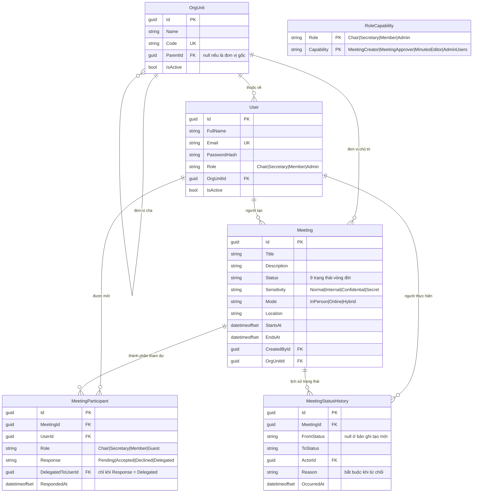

# Mô hình dữ liệu (ERD)

Lát cắt đầu tiên của cơ sở dữ liệu, đúng phạm vi `SCRUM-45`: **người dùng, đơn vị, cuộc họp, lịch
sử trạng thái, thành phần tham dự**. Nghị sự, tài liệu, biểu quyết, ghi âm và biên bản sẽ vào các
lát cắt sau — đừng thêm bảng cho chúng trước khi Use Case tương ứng được BA chốt.

Hiện thực: EF Core 10 code-first, PostgreSQL qua Npgsql ([ADR-0003](../05-decisions/0003-chon-postgresql-thay-cho-sql-server.md)). Entity nằm ở
[backend/TrustCabinet.Domain/Entities/](../../backend/TrustCabinet.Domain/Entities/), cấu hình bảng
ở [backend/TrustCabinet.Infrastructure/Configurations/](../../backend/TrustCabinet.Infrastructure/Configurations/).
Cách chạy: [03-co-so-du-lieu.md](03-co-so-du-lieu.md).

## Sơ đồ

`RoleCapability` không nối khoá ngoại tới `User`: nó là bảng tra cứu giữa vai trò và quyền, không
phải quan hệ giữa hai thực thể.

Tên trong sơ đồ là tên entity C#. Trong database chúng thành snake_case: `org_units`, `users`,
`role_capabilities`, `meetings`, `meeting_participants`, `meeting_status_history`.

## Những quyết định cần biết

| Quyết định | Lý do |
|---|---|
| Khoá chính `uuid`, sinh bằng `Guid.CreateVersion7()` | Không đoán được từ bên ngoài (link tài liệu mật sau này cần điều đó), nhưng vẫn tăng dần theo thời gian nên chèn tuần tự không làm phân mảnh index như GUID v4 |
| Tên bảng và cột **snake_case** | PostgreSQL hạ chữ thường identifier không đóng ngoặc kép; giữ PascalCase thì mọi câu SQL viết tay phải gõ `"Meetings"` |
| `users.email` kiểu **`citext`** | PostgreSQL so sánh chuỗi phân biệt hoa thường. Không đổi kiểu thì unique index vẫn cho `Anh@x.vn` và `anh@x.vn` thành hai tài khoản |
| Enum lưu dạng **chuỗi**, không phải số | Đọc thẳng trong SSMS là hiểu; thêm trạng thái mới về sau không đánh số lại các dòng đã ghi |
| `Meeting.Status` và `Sensitivity` **không có giá trị mặc định** ở DB | Tầng ứng dụng phải nói rõ. Mặc định ngầm về giá trị dễ dãi nhất là cách một cuộc họp mật bị lộ |
| `User.IsActive` / `OrgUnit.IsActive` thay cho xoá cứng | Người đã nghỉ vẫn là chủ toạ của cuộc họp quý trước; xoá họ là mất quy kết trách nhiệm |
| Khoá ngoại trỏ tới `User` đều `Restrict` | Không cho phép xoá người dùng kéo theo bằng chứng kiểm toán |
| `Meeting` → participant/history là `Cascade` | Xoá một cuộc họp nháp thì dữ liệu con đi theo, không để lại rác |
| `MeetingStatusHistory` chỉ ghi thêm | Đây là bằng chứng, không phải log kỹ thuật. Ứng dụng không bao giờ `UPDATE`/`DELETE` bảng này |
| Không có cột `Salt` riêng | Hàm băm hiện đại nhúng thuật toán, tham số và salt vào chính chuỗi hash |
| Vai trò hệ thống ≠ vai trò trong cuộc họp | `User.Role` là vị trí trong tổ chức; `MeetingParticipant.Role` là vai trong một phiên họp cụ thể. Một `Member` vẫn có thể chủ toạ một cuộc họp |

Bảng `RoleCapability` được seed **trong migration** (dữ liệu tham chiếu, không phải dữ liệu người
dùng nhập), nên mọi database vừa migrate xong đều thống nhất với code. Bảng tạm
`ROLE_CAPABILITIES` trong [frontend/src/types/user.ts](../../frontend/src/types/user.ts) sẽ bị xoá
ở `SCRUM-46` — nguồn sự thật là bảng này.

## Tham chiếu AI-eCabinet: lấy gì, bỏ gì

Hệ thống gốc có 34 bảng trên PostgreSQL. Phần lớn là hạ tầng nằm ngoài phạm vi đồ án.

**Giữ lại ý tưởng:**

- Tách `meeting_lifecycle_events` thành bảng riêng, chỉ ghi thêm → `MeetingStatusHistory`
- `sensitivity` là trục độc lập với `status`
- `documents` + `document_versions` (lát cắt sau, `SCRUM-21`)
- Vai trò trong cuộc họp tách khỏi vai trò hệ thống

**Bỏ hẳn, và vì sao:**

| Của hệ thống gốc | Vì sao không làm |
|---|---|
| `tenants` + Row-Level Security trên mọi bảng | TrustCabinet phục vụ một tổ chức. Multi-tenant là cả một lớp kiến trúc, không phải một cột |
| Kiểu `text[]`, `jsonb` cho lựa chọn biểu quyết | Lát cắt sau mới bàn; PostgreSQL có sẵn nên vẫn dùng được khi tới `SCRUM-28` |
| `residency_zone`, `key_domain`, `key_id` trên mọi bảng | Đi kèm yêu cầu lưu trú dữ liệu và mã hoá theo vùng — ngoài phạm vi |
| `persons` + `sessions` + `iss`/`sub` (Zitadel) | Đăng nhập nội bộ bằng email/mật khẩu (`SCRUM-11`), không tích hợp IdP ngoài |
| `relation_tuples`, `authz_epochs` (ReBAC kiểu OpenFGA) | Dùng RBAC phẳng: vai trò → quyền. Đủ cho 4 vai trò |
| `encryption_keys`, `key_shred_ledger` | Không làm mã hoá phong bì và xoá bằng huỷ khoá |
| `job_outbox`, `job_stage`, `pipeline_job`, `job_idempotency` | Không dựng job spine; ASR chạy đồng bộ hoặc hàng đợi đơn giản |
| `audit_log` với chuỗi hash | `SCRUM-16` chỉ cần nhật ký chỉ-ghi-thêm, không cần chuỗi hash chống sửa |
| `meeting_external_participants` | Lát cắt sau nếu `SCRUM-20` cần khách mời ngoài hệ thống |

**Thêm so với hệ thống gốc:** `Meeting.Mode` (`InPerson`/`Online`/`Hybrid`) — hệ thống gốc không có
cột này vì không tự làm phần gọi. TrustCabinet có gọi thoại/video trong ứng dụng nên hình thức họp
là dữ liệu nghiệp vụ.
