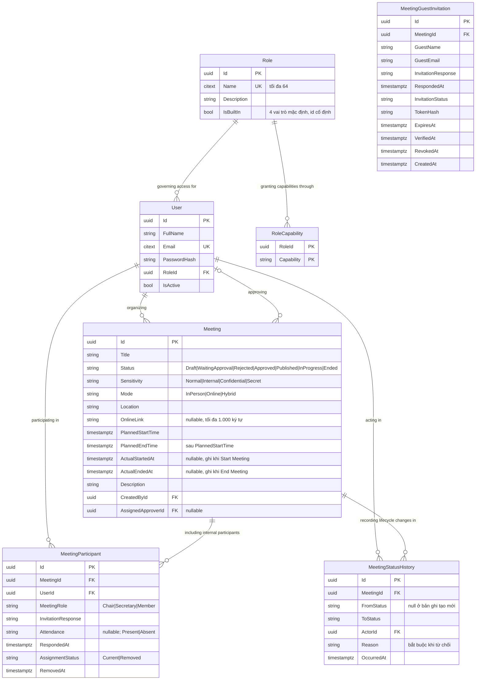
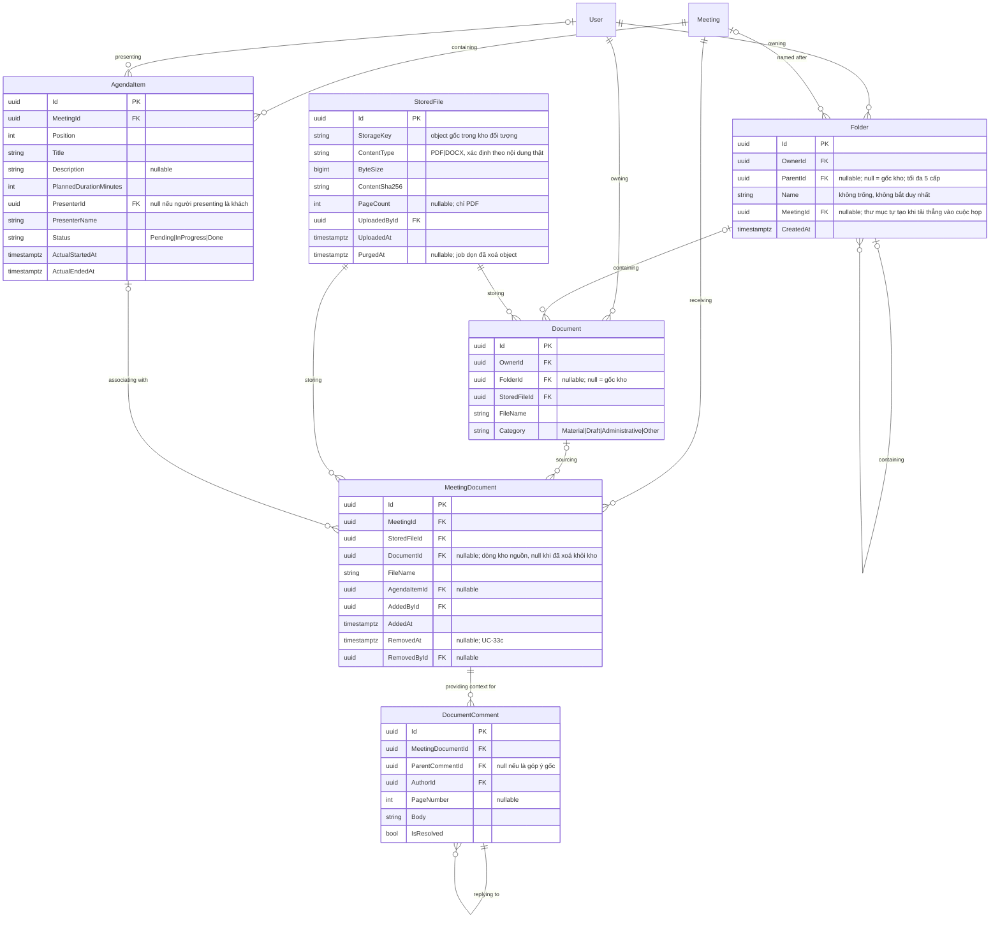
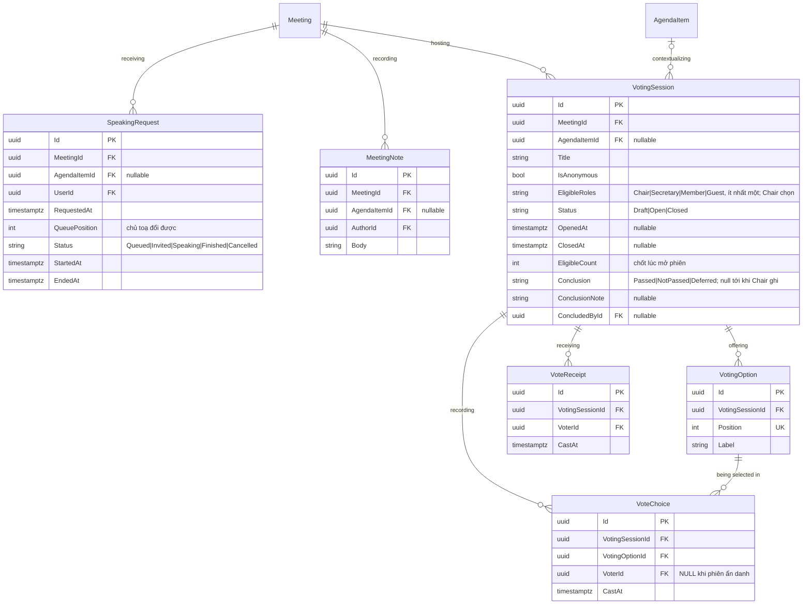
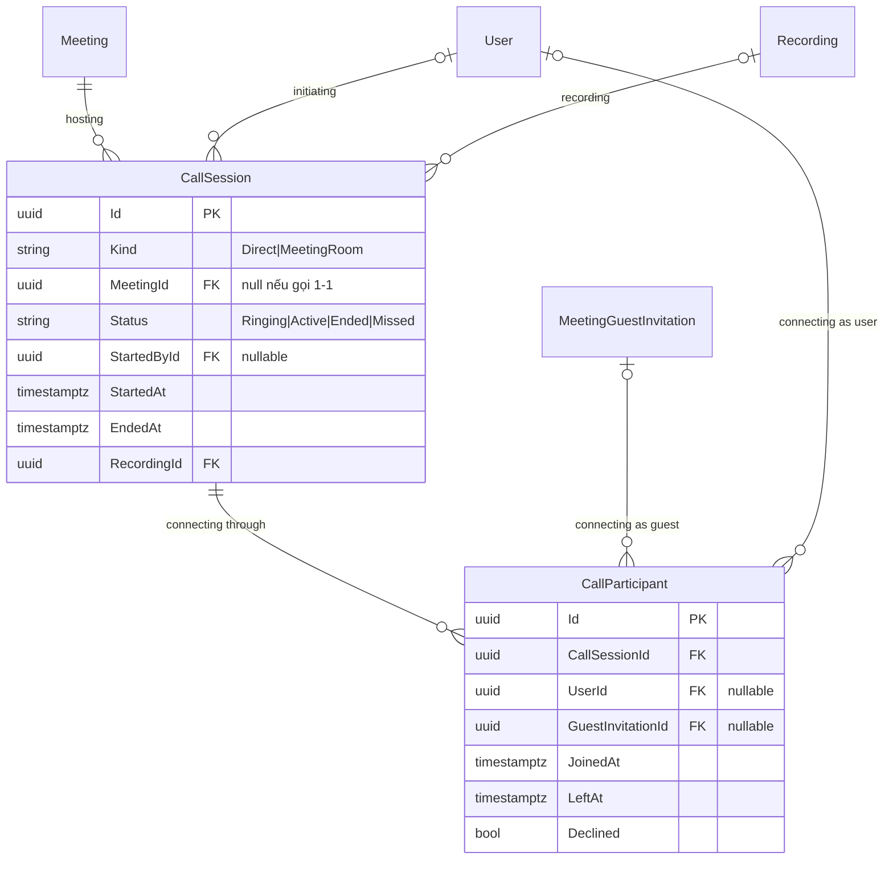

# Mô hình dữ liệu (ERD)

**Hiện thực Backend SCRUM-20 / SCRUM-97 theo PO 20/10/2026:** MeetingParticipant có AssignmentStatus/RemovedAt/RemovedById/InitialInvitationDeliveryKey; Meeting có ParticipantsRevision. Hai bảng mới: MeetingGuestInvitation, MeetingInvitationDispatch. Không có bảng quyền bổ sung; quyền roster theo current Chair/Secretary active. Unique current assignment/Guest email/Chair; ứng dụng giữ đúng một Chair, migration backfill creator khi thiếu. Guest credential/profile/session production thuộc SCRUM-59. Chi tiết: [API §6](../03-api/09-thanh-phan-tham-du.md#6-migration-và-delivery), [ADR-0021](../05-decisions/0021-vong-doi-thanh-phan-va-y-dinh-gui-thu.md). Hình mục tiêu bên dưới chưa phải snapshot schema hiện thực.

Tài liệu này mô tả **mô hình dữ liệu khái niệm/logic mục tiêu** của TrustCabinet để làm nguồn cho Report 3, không phải bản trích xuất schema hiện tại. Mô hình đích có đúng **30 thực thể nghiệp vụ/dữ liệu** (thêm `Folder` ngày 13/10/2026, ADR-0018), khớp Report 3 §I.3.2 và ERD vẽ ở [assets/erd-muc-tieu/](../assets/erd-muc-tieu/). Hệ thống được triển khai bằng EF Core code-first và PostgreSQL; thay đổi ERD không tự thay đổi entity, cấu hình, schema hay migration.

**ERD thực thể–quan hệ:** [file drawio chỉnh sửa được](../assets/erd-chen/trustcabinet-erd-chen.drawio),
[PDF một trang](../assets/erd-chen/trustcabinet-erd-chen.pdf) và
[ảnh toàn bộ mô hình](../assets/erd-chen/trustcabinet-erd-chen.png). Một ảnh chứa toàn bộ
30 thực thể hình chữ nhật và 49 quan hệ hình thoi; action trong hình thoi dùng tiếng Anh.
Bội số thể hiện bằng đầu nối crow’s foot, không ghi số trên đường nối. Sơ đồ bỏ thuộc tính
để tập trung vào thực thể và quan hệ, bố trí quanh Meeting và User theo DB design hiện có.
Bản dạng bảng ở `erd-muc-tieu/` được giữ để đối chiếu các thuộc tính và thiết kế dữ liệu.

Hiện thực: EF Core 10 code-first, PostgreSQL qua Npgsql
([ADR-0003](../05-decisions/0003-chon-postgresql-thay-cho-sql-server.md)). Entity ở
[backend/TrustCabinet.Domain/Entities/](../../backend/TrustCabinet.Domain/Entities/), cấu hình bảng
ở [backend/TrustCabinet.Infrastructure/Configurations/](../../backend/TrustCabinet.Infrastructure/Configurations/).
Cách chạy: [03-co-so-du-lieu.md](03-co-so-du-lieu.md).

Thứ tự nguồn sự thật khi có khác biệt: **Requirement/Use Case/Business Rules mới nhất → ADR đã chốt và còn phù hợp → code hiện tại để xác định trạng thái triển khai**. Vì vậy code có thể cần migration hoặc tái cấu trúc để đạt mô hình đích. Xung đột giữa mô hình đích và ADR được nêu ở cuối tài liệu; phạm vi này không sửa ADR.

Vòng đời Meeting là `Draft → WaitingApproval → Approved | Rejected → Published → InProgress → Ended`; Meeting bị từ chối có thể được gửi duyệt lại. Trạng thái biên bản nằm ở `MeetingMinutes.Status`. Một Meeting là một buổi họp và tự mang lịch dự kiến; không có MeetingSession ([ADR-0013](../05-decisions/0013-mot-cuoc-hop-la-mot-buoi-hop.md)). Biểu quyết chỉ diễn ra khi Meeting `InProgress` ([ADR-0014](../05-decisions/0014-bieu-quyet-chi-trong-cuoc-hop.md)).

## Trạng thái triển khai

Các trạng thái dưới đây nói về code/schema hiện tại. `NOT IMPLEMENTED` là entity của mô hình đích chưa tồn tại trong domain/schema; không được hiểu là bảng hiện có.

| Entity | Mục đích trong mô hình đích | Trạng thái code | Thay đổi cần thiết |
|---|---|---|---|
| User | Tài khoản nội bộ | IMPLEMENTED | Giữ. |
| Role | Vai trò RBAC cấp hệ thống | IMPLEMENTED | Giữ; độc lập với MeetingRole. |
| RoleCapability | Quyền năng gắn với Role | IMPLEMENTED | Giữ. |
| Meeting | Hồ sơ, lịch và vòng đời cuộc họp (một cuộc họp = một buổi họp) | IMPLEMENTED | Đã có `PlannedStartTime`, `PlannedEndTime`, `ActualStartedAt`, `ActualEndedAt`, `OnlineLink`; đã bỏ `Sessions`, `MinutesIssued`, `Archived` (migration `MeetingOwnsScheduleDropSessions`, ADR-0013). |
| MeetingStatusHistory | Bằng chứng chuyển trạng thái | NEED MIGRATION / RESTRUCTURE | Giữ append-only; đồng bộ vòng đời đích. |
| MeetingParticipant | Phân công người tham dự nội bộ | NEED MIGRATION / RESTRUCTURE | Bỏ Guest; hỗ trợ phân công Current/Removed và lưu lịch sử. |
| MeetingGuestInvitation | Lời mời khách ngoài theo cuộc họp | NOT IMPLEMENTED | Thêm entity riêng; khách không phải User/người tham dự nội bộ. |
| AgendaItem | Mục nghị sự của cuộc họp | NEED MIGRATION / RESTRUCTURE | Giữ MeetingId (không đổi sang MeetingSessionId); trạng thái đích Pending/InProgress/Done. |
| Notification | Thông báo của User | IMPLEMENTED | Giữ User bắt buộc, Meeting tùy chọn. |
| Document | Một dòng trong kho cá nhân, trỏ tới một StoredFile | NEED MIGRATION / RESTRUCTURE | Bỏ MeetingId/AgendaItemId/CurrentVersionId; thêm OwnerId, FolderId, StoredFileId, FileName (ADR-0018). |
| StoredFile | File bất biến trong kho đối tượng; kho cá nhân và cuộc họp chỉ tham chiếu tới nó | NEED MIGRATION / RESTRUCTURE | Code đang là `DocumentVersion`: đổi thành StoredFile, bỏ DocumentId/VersionNumber, thêm PageCount, UploadedAt, PurgedAt (ADR-0018). |
| Folder | Thư mục trong kho cá nhân, lồng tối đa 5 cấp (như AI-eCabinet) | NOT IMPLEMENTED | Thêm; `MeetingId` cho thư mục tự tạo khi tải thẳng vào cuộc họp (ADR-0018). |
| MeetingDocument | Một dòng tài liệu trong cuộc họp, trỏ tới một StoredFile | NOT IMPLEMENTED | Thêm; tham chiếu StoredFile (không chép byte), Document nguồn tuỳ chọn, gỡ bằng RemovedAt (ADR-0018). |
| DocumentComment | Góp ý trong ngữ cảnh tài liệu đính kèm cuộc họp | NEED MIGRATION / RESTRUCTURE | Đổi DocumentId thành MeetingDocumentId. |
| SpeakingRequest | Yêu cầu/lượt phát biểu | IMPLEMENTED | Giữ. |
| MeetingNote | Ghi chú thư ký | IMPLEMENTED | Giữ. |
| VotingSession | Một lần biểu quyết trong cuộc họp | NEED MIGRATION / RESTRUCTURE | Bỏ `Kind`, `OpensAt`, `ClosesAt`; thêm `OpenedAt`, `ClosedAt`, `ConclusionNote`, `ConcludedById`, `EligibleRoles` (Chủ toạ chọn vai trò được bỏ phiếu, như AI-eCabinet); `Conclusion` thành Passed/NotPassed/Deferred; AgendaItem liên kết tùy chọn (ADR-0014). |
| VotingOption | Phương án | IMPLEMENTED | Giữ. |
| VoteReceipt | Bằng chứng người bỏ phiếu đã bỏ phiếu | IMPLEMENTED | Giữ tính duy nhất theo session và voter. |
| VoteChoice | Lựa chọn đã bỏ | IMPLEMENTED | Giữ tách khỏi receipt; voter nullable nếu ẩn danh. |
| Recording | Bản ghi âm do Thư ký upload | NEED MIGRATION / RESTRUCTURE | Thêm `UploadedById`; `Source` chỉ còn `Upload`; giữ consent, mục đích, lưu giữ và xóa dữ liệu cá nhân. |
| Transcript | Transcript của Recording | IMPLEMENTED | Tối đa một cho mỗi Recording. |
| TranscriptSegment | Đoạn transcript | IMPLEMENTED | Giữ. |
| MeetingMinutes | Phiên bản biên bản | NEED MIGRATION / RESTRUCTURE | Trạng thái Draft/PendingSignature/RevisionRequested/Sealed/Superseded; bỏ `ApprovedById`, `RejectionReason`, `IssuedAt`; thêm `RevisionNote`, `SealedById`, `SealedAt`. Không ghi đè bản đã niêm phong. |
| MinutesSignature | Chữ ký trên phiên bản biên bản | NEED MIGRATION / RESTRUCTURE | Thêm `InvalidatedAt` (chữ ký cũ mất hiệu lực khi biên bản bị yêu cầu sửa — BR-166). |
| MeetingSummary | Tóm tắt AI hiện hành | NEED MIGRATION / RESTRUCTURE | Thêm `Status` Draft/Approved/Published, `ApprovedById`, `ApprovedAt`, `PublishedAt` (duyệt và công bố là hai bước); tối đa một bản hiện hành mỗi Meeting. |
| EmailMessage | Bản ghi gửi email/outbox | IMPLEMENTED | Giữ khóa chống trùng và thông tin thử gửi lại. |
| AuditLogEntry | Bằng chứng kiểm toán nghiệp vụ | IMPLEMENTED | Chỉ ghi thêm. |
| CallSession | Lượt gọi hoặc phòng trực tuyến | NEED MIGRATION / RESTRUCTURE | StartedById nullable; phòng gắn với Meeting. |
| CallParticipant | Một lượt kết nối của User hoặc khách | NEED MIGRATION / RESTRUCTURE | UserId XOR GuestInvitationId. |

`MeetingSession` (bảng `meeting_sessions`) **đã bị bỏ** từ 09/10/2026 ([ADR-0013](../05-decisions/0013-mot-cuoc-hop-la-mot-buoi-hop.md)). Migration `MeetingOwnsScheduleDropSessions` chép lịch về `meetings` rồi drop bảng; migration cũ trên `main` giữ nguyên.

## Phạm vi mô hình đích

Các ERD bên dưới mô tả mô hình đích. Bảng trạng thái triển khai ở trên phân biệt mô hình đích với code hiện hành.

## Nhóm thực thể trong mô hình đích

| Nhóm | Thực thể |
|---|---|
| Truy cập | User, Role, RoleCapability |
| Cuộc họp, thành phần và nghị sự | Meeting, MeetingStatusHistory, MeetingParticipant, MeetingGuestInvitation, AgendaItem |
| Nền tảng và liên lạc | Notification, EmailMessage, AuditLogEntry |
| Kho tài liệu cá nhân | Folder, Document, StoredFile, MeetingDocument, DocumentComment |
| Hoạt động trong cuộc họp | SpeakingRequest, MeetingNote, VotingSession, VotingOption, VoteReceipt, VoteChoice |
| Bản ghi, biên bản và AI sau họp | Recording, Transcript, TranscriptSegment, MeetingMinutes, MinutesSignature, MeetingSummary |
| Phòng họp trực tuyến | CallSession, CallParticipant |

Các nhóm trên gồm 30 thực thể; trạng thái triển khai được liệt kê riêng ở trên.

## 1. Truy cập, cuộc họp và thành phần tham dự



`InvitationResponse` và `Attendance` là **hai câu hỏi khác nhau**: một là người ta trả lời thư mời thế nào,
hai là thực tế có mặt hay không. Nhận lời rồi không đến là chuyện bình thường; điểm danh trong biên bản và báo cáo dùng `Attendance`.
Không có quorum (ADR-0014), và phản hồi lời mời chỉ còn Accepted/Declined — không uỷ quyền phản hồi (BR-105).

Guest không có User account, system Role hoặc internal MeetingRole; quyền Guest theo Member và có thể được cấp bổ sung trong Meeting và chỉ trong meeting được mời. Email phải được xác minh trước khi thiết lập guest session.

## 2. Nghị sự và tài liệu



Tài liệu **không có phiên bản** ([ADR-0018](../05-decisions/0018-tai-lieu-khong-phien-ban-chi-giu-tham-chieu.md)). Mỗi lần tải lên tạo một `StoredFile` bất biến; dòng trong kho cá nhân (`Document`) và dòng trong cuộc họp (`MeetingDocument`) chỉ tham chiếu tới nó, gắn vào cuộc họp không chép byte. Muốn đổi nội dung thì tải file mới, gắn vào, gỡ file cũ. Xoá khỏi kho chỉ xoá dòng `Document`; cuộc họp vẫn đọc được vì giữ tham chiếu riêng. Job nền định kỳ xoá object của `StoredFile` không còn dòng `Document` nào và không còn `MeetingDocument` đang hiệu lực (`RemovedAt` null), rồi đánh dấu `PurgedAt`. Server không chuyển đổi file; trình duyệt dựng bản xem (PDF từng trang bằng pdf.js, DOCX liền một khối bằng `docx-preview`). Kho có thư mục như AI-eCabinet; tải thẳng từ máy vào cuộc họp thì dòng kho vào thư mục `<tên cuộc họp> - dd/mm/yyyy` của người tải (`Folder.MeetingId`). Comment trỏ vào MeetingDocument để giữ đúng meeting context.

> **`Document.MeetingId` đang có trong code nhưng không thuộc target.**
> [ADR-0006](../05-decisions/0006-kho-tai-lieu-ca-nhan-va-quyen-doc.md) chốt tách tài liệu thành
> **kho cá nhân** (chủ sở hữu là người tải lên) cộng với bảng nối `MeetingDocument` để gắn vào
> cuộc họp. Khi đó `AgendaItemId` chuyển từ `Document` sang dòng gắn kết, `DocumentComment` cũng
> trỏ vào dòng gắn kết thay vì vào `Document`. [ADR-0018](../05-decisions/0018-tai-lieu-khong-phien-ban-chi-giu-tham-chieu.md)
> bỏ phiên bản: `DocumentVersion` trong code thành `StoredFile`, cả kho lẫn cuộc họp chỉ tham chiếu tới nó.
> Sơ đồ này là target model; implementation hiện tại vẫn cần migration/restructure.

## 3. Biểu quyết và hoạt động trong cuộc họp



### Biểu quyết ẩn danh — đọc kỹ chỗ này

Tách **`VoteReceipt`** (ai đã bỏ phiếu) khỏi **`VoteChoice`** (phiếu chọn gì) là cách làm cho phiếu
kín thực sự kín:

- `VoteReceipt` có unique index `(VotingSessionId, VoterId)` → một người một phiếu, do database ép,
  không phải do một câu `if` mà hai request đồng thời có thể cùng vượt qua.
- `VoteChoice.VoterId` **để NULL khi phiên ẩn danh** → không dòng nào trong database nối người với
  lựa chọn. Ẩn tên trên giao diện là không đủ: liên kết vẫn nằm đó cho bất cứ ai đọc được DB.

**Hệ quả phải biết:** phiên ẩn danh thì **không đổi phiếu được**, vì không có gì xác định phải thay
dòng nào. `SCRUM-28` yêu cầu đổi phiếu tới khi đóng phiên — hiện chỉ làm được với phiên công khai. (Report 3 mới, màn 11.3: một phiếu không đổi được sau khi nộp — nếu giữ quy tắc này thì vấn đề tự hết.)
Muốn có cả hai thì cần cơ chế token cấp cho từng người bỏ phiếu, và đó là một quyết định thiết kế
riêng, không phải thứ chắp thêm. **Việc này cần BA chốt trước khi `SCRUM-28` bắt đầu.**

## 7. Bản ghi, transcript, biên bản và AI

```mermaid
erDiagram
    Meeting ||--o{ Recording : "recording"
    Recording ||--o| Transcript : "transcribing"
    Transcript ||--o{ TranscriptSegment : "containing"
    Meeting ||--o{ MeetingMinutes : "issuing"
    MeetingMinutes ||--o{ MinutesSignature : "receiving"
    MeetingMinutes ||--o| MeetingMinutes : "superseding"
    Meeting ||--o| MeetingSummary : "generating"
    User ||--o{ Recording : "uploading"
    User ||--o{ MinutesSignature : "signing"

    Recording {
        uuid Id PK
        uuid MeetingId FK
        uuid UploadedById FK "Secretary"
        string Source "Upload"
        string Status "Pending|Available|Failed|Deleted"
        string StoragePath
        bigint DurationMs
        timestamptz ConsentObtainedAt "bắt buộc trước khi ghi"
        string ConsentPurpose
        timestamptz RetainUntil
        timestamptz DeletedAt
    }
    Transcript {
        uuid Id PK
        uuid RecordingId FK UK
        string Status "Pending|Processing|Completed|Failed"
        string Provider "ghi rõ nếu là dịch vụ ngoài"
        string Language
        int ProgressPercent
        string ErrorMessage
    }
    TranscriptSegment {
        uuid Id PK
        uuid TranscriptId FK
        int Position UK
        bigint StartMs
        bigint EndMs
        string Text
        string SpeakerLabel "Người nói 1, 2, 3…"
        uuid SpeakerUserId FK "thư ký gán tay"
        uuid EditedById FK
    }
    MeetingMinutes {
        uuid Id PK
        uuid MeetingId FK
        int RevisionNumber UK
        uuid SupersedesId FK
        string Content
        string Status "Draft|PendingSignature|RevisionRequested|Sealed|Superseded"
        uuid CreatedById FK
        string RevisionNote "nullable"
        uuid SealedById FK "nullable"
        timestamptz SealedAt "đặt rồi là khoá"
    }
    MinutesSignature {
        uuid Id PK
        uuid MinutesId FK
        uuid SignerId FK
        timestamptz SignedAt
        string ContentSha256
        string Signature
        string PublicKey
        timestamptz InvalidatedAt "nullable"
    }
    MeetingSummary {
        uuid Id PK
        uuid MeetingId FK UK
        string Content
        string Model
        string Status "Draft|Approved|Published"
        timestamptz GeneratedAt
        uuid ApprovedById FK "nullable"
        timestamptz ApprovedAt "nullable"
        timestamptz PublishedAt "nullable"
    }
```

## 8. Phòng họp trực tuyến

Phòng trực tuyến thuộc Meeting và chỉ mở khi Meeting `InProgress` với hình thức Online/Hybrid. CallSession là một lượt mở phòng, không phải một buổi họp; việc vào/ra phòng không làm thay đổi lifecycle cuộc họp.



Chỉ lưu **sự kiện cuộc gọi**, không lưu media. Mỗi CallParticipant phải tham chiếu đúng một identity: User XOR MeetingGuestInvitation. Rớt mạng vào lại sinh một dòng mới cho connection stint tiếp theo. Mỗi Meeting có tối đa một MeetingRoom CallSession Active.

Từ [ADR-0010](../05-decisions/0010-phong-hop-truc-tuyen-dung-livekit-sfu.md), âm thanh, hình và
signalling đi qua LiveKit (SFU), không phải trực tiếp giữa các trình duyệt, và backend không làm tín
hiệu. Phiên phòng họp được tạo từ webhook `participant_joined` của LiveKit, không phải lúc cấp token.
Index duy nhất có điều kiện `ux_call_sessions_active_meeting_room` (`meeting_id` khi
`status = 'Active'`) bảo đảm mỗi cuộc họp chỉ có một phiên đang mở, kể cả khi hai webhook tới cùng
lúc.

## 9. Nền tảng, thông báo và kiểm toán

`Notification` thuộc về đúng một User (`UserId`) và có thể trỏ tới một Meeting
(`meeting_id`). `read_at` null nghĩa là chưa đọc. `deduplication_key` nullable có unique index;
nhắc họp dùng `meeting-starting-soon:<meeting-id>:<user-id>`. Notification lời mời sẽ được tạo cho
tất cả participant trong luồng publish meeting của SCRUM-19, không phải khi thêm từng participant.
`pushed_at` null nghĩa là worker chưa push dòng đã commit qua SignalR; client mất kết nối vẫn
đọc lại từ DB qua API. Migration SCRUM-14 thêm bốn cột `deduplication_key`, `pushed_at`,
`target_type` và `target_id` mà không thay đổi quan hệ user/meeting có sẵn.

`email_messages.deduplication_key` cũng có unique index nhưng định danh một **sự kiện gửi cụ thể**,
không phải chỉ một cặp meeting/người nhận. Nhờ đó retry transaction của cùng lần công bố không tạo
thư trùng, còn các sự kiện đổi lịch hoặc gửi ký biên bản vẫn có thể gửi thư mới cho cùng
người nhận.

Notification lưu `target_type` và `target_id`; với thông báo họp, các giá trị là `Meeting` và ID
cuộc họp. Route UI không được lưu trong database: API dựng `actionUrl` từ hai trường target khi trả
response, nên thay đổi route không làm hỏng các notification đã có. `meeting_id` tiếp tục là khóa
ngoại để giữ quan hệ và bảo vệ tính toàn vẹn dữ liệu. Migration điền target và đánh dấu các dòng
cũ đã được xử lý realtime để worker không push lại hàng loạt ở lần chạy đầu. `isRead` được suy ra
từ `read_at`, không lưu thêm một cột bool.

```mermaid
erDiagram
    User ||--o{ Notification : "receiving"
    Meeting o|--o{ Notification : "providing context for"
    Meeting o|--o{ EmailMessage : "triggering"
    User o|--o{ AuditLogEntry : "acting in"

    Notification {
        uuid Id PK
        uuid UserId FK
        uuid MeetingId FK "nullable"
        string TargetType
        uuid TargetId
        timestamptz ReadAt "nullable"
    }
    EmailMessage {
        uuid Id PK
        uuid MeetingId FK "nullable"
        string DeduplicationKey
        string Status
        int RetryCount
        timestamptz CreatedAt
    }
    AuditLogEntry {
        uuid Id PK
        uuid ActorId FK "nullable"
        string Action
        string ObjectType
        uuid ObjectId
        string IpAddress
        json Details
        timestamptz OccurredAt
    }
}
```
## Tổng hợp đầy đủ các quan hệ

| Thực thể nguồn | Số lượng liên kết | Thực thể đích | Quan hệ nghiệp vụ |
|---|---:|---|---|
| Role | 1 → 0..* | User | Quy định quyền truy cập |
| Role | 1 → 0..* | RoleCapability | Cấp quyền năng thông qua |
| User | 1 → 0..* | Meeting | Tổ chức |
| User | 0..1 → 0..* | Meeting | Phê duyệt; mỗi Meeting có tối đa một người duyệt được gán |
| Meeting | 1 → 0..* | MeetingStatusHistory | Ghi lại thay đổi vòng đời |
| User | 1 → 0..* | MeetingStatusHistory | Thực hiện hành động |
| Meeting | 1 → 0..* | MeetingParticipant | Bao gồm thành phần nội bộ |
| User | 1 → 0..* | MeetingParticipant | Tham gia |
| Meeting | 1 → 0..* | MeetingGuestInvitation | Mời khách |
| Meeting | 1 → 0..* | AgendaItem | Chứa |
| User | 0..* → 0..1 | AgendaItem | Trình bày |
| User | 1 → 0..* | Document | Sở hữu |
| User | 1 → 0..* | Folder | Sở hữu |
| Folder | 0..1 → 0..* | Folder | Chứa thư mục con |
| Folder | 0..1 → 0..* | Document | Chứa |
| Meeting | 0..1 → 0..* | Folder | Đặt tên cho thư mục tải thẳng vào cuộc họp |
| StoredFile | 1 → 0..* | Document | Lưu nội dung cho dòng kho |
| User | 1 → 0..* | StoredFile | Tải lên |
| Meeting | 1 → 0..* | MeetingDocument | Nhận tài liệu |
| Document | 0..1 → 0..* | MeetingDocument | Là nguồn (null khi đã xoá khỏi kho) |
| StoredFile | 1 → 0..* | MeetingDocument | Lưu nội dung cho tài liệu cuộc họp |
| AgendaItem | 0..1 → 0..* | MeetingDocument | Gắn với |
| MeetingDocument | 1 → 0..* | DocumentComment | Cung cấp ngữ cảnh cho |
| DocumentComment | 0..1 → 0..* | DocumentComment | Trả lời |
| Meeting | 1 → 0..* | SpeakingRequest | Tiếp nhận |
| Meeting | 1 → 0..* | MeetingNote | Ghi nhận |
| Meeting | 1 → 0..* | VotingSession | Tổ chức |
| AgendaItem | 0..1 → 0..* | VotingSession | Cung cấp ngữ cảnh cho |
| VotingSession | 1 → 1..* | VotingOption | Đưa ra lựa chọn |
| VotingSession | 1 → 0..* | VoteReceipt | Ghi nhận việc bỏ phiếu |
| VotingSession | 1 → 0..* | VoteChoice | Ghi nhận lựa chọn |
| VotingOption | 1 → 0..* | VoteChoice | Được chọn trong |
| User | 1 → 0..* | VoteReceipt | Bỏ phiếu |
| Meeting | 1 → 0..* | Recording | Ghi âm |
| User | 1 → 0..* | Recording | Tải lên (Secretary) |
| Recording | 1 → 0..1 | Transcript | Chuyển thành văn bản |
| Transcript | 1 → 0..* | TranscriptSegment | Chứa |
| Meeting | 1 → 0..* | MeetingMinutes | Ban hành |
| MeetingMinutes | 1 → 0..* | MinutesSignature | Nhận chữ ký |
| User | 1 → 0..* | MinutesSignature | Ký |
| MeetingMinutes | 0..1 → 0..1 | MeetingMinutes | Thay thế phiên bản trước |
| Meeting | 1 → 0..1 | MeetingSummary | Tạo tóm tắt |
| User | 1 → 0..* | Notification | Nhận |
| Meeting | 0..1 → 0..* | Notification | Cung cấp ngữ cảnh cho |
| Meeting | 0..1 → 0..* | EmailMessage | Kích hoạt gửi |
| User | 0..1 → 0..* | AuditLogEntry | Thực hiện hành động |
| Meeting | 0..1 → 0..* | CallSession | Cung cấp phòng |
| CallSession | 1 → 0..* | CallParticipant | Kết nối qua |
| User | 0..1 → 0..* | CallParticipant | Kết nối với tư cách nội bộ |
| MeetingGuestInvitation | 0..1 → 0..* | CallParticipant | Kết nối với tư cách khách ngoài |

## Quy tắc nghiệp vụ và ràng buộc dữ liệu không thể hiện trên ERD

1. Lịch dự kiến thuộc Meeting: `PlannedStartTime` và `PlannedEndTime` bắt buộc, `PlannedEndTime > PlannedStartTime`; khi tạo, giờ bắt đầu phải ở tương lai (BR-62, BR-162). Không có MeetingSession; một Meeting là một buổi họp (ADR-0013).
2. `ActualStartedAt`/`ActualEndedAt` do hệ thống ghi khi Start Meeting (Published → InProgress) và End Meeting (InProgress → Ended). Sau `Published` chỉ Organizer được dời `PlannedStartTime`, `PlannedEndTime`, `Location`, `OnlineLink`; mỗi lần dời phải thông báo người được mời (BR-75, BR-76, BR-158).
3. Mỗi AgendaItem thuộc đúng một Meeting; chỉ sắp xếp lại trong Meeting đó; mỗi Meeting có tối đa một AgendaItem InProgress. Trạng thái đích: Pending → InProgress → Done. Kết thúc Meeting tự hoàn tất mục đang chạy trong cùng transaction (BR-159).
4. Mỗi participant nội bộ có đúng một MeetingRole: Chair, Secretary hoặc Member. MeetingRole độc lập với system Role.
5. Guest bên ngoài không có User account hay system Role; quyền Guest theo Member và có thể được cấp bổ sung trong Meeting và chỉ áp dụng trong Meeting được mời. Phải xác minh email trước khi thiết lập guest session.
6. Mỗi cặp (MeetingId, UserId) có tối đa một phân công Current. Khuyến nghị dùng unique index có điều kiện trên `(meeting_id, user_id)` khi trạng thái phân công là Current. Giữ bằng chứng Removed/lịch sử khi cần truy vết.
7. Mỗi cặp (MeetingId, GuestEmail) có tối đa một lời mời Guest còn hiệu lực. Không mời email Guest nếu email đó đã thuộc một participant nội bộ hiện hành trong cùng Meeting.
8. Để công bố hoặc bắt đầu Meeting, phải có đúng một Chair và ít nhất một Secretary đang được phân công hiện hành, đồng thời tài khoản của họ còn hoạt động (BR-124, BR-125, BR-127).
9. Phản hồi lời mời chỉ là Accepted hoặc Declined; không có uỷ quyền phản hồi (BR-105). Điểm danh chỉ Present/Absent; chưa ghi nhận giữ null, không coi là Absent.
10. MeetingDocument tham chiếu một StoredFile bất biến; mỗi StoredFile có tối đa một MeetingDocument đang hiệu lực (`RemovedAt` null) trong mỗi Meeting. Nếu có AgendaItemId, AgendaItem đó phải thuộc cùng Meeting. Không gỡ được khi Meeting đã có biên bản (BR-185).
11. VoteReceipt duy nhất theo (VotingSessionId, VoterId). VoteChoice ẩn danh phải có VoterId null; không gộp receipt với choice.
12. Mỗi Recording có tối đa một Transcript; mỗi Meeting có tối đa một MeetingSummary hiện hành.
13. MeetingStatusHistory và AuditLogEntry là bằng chứng chỉ ghi thêm.
14. Phòng trực tuyến thuộc Meeting và chỉ mở khi Meeting `InProgress` với hình thức Online/Hybrid. Vào/rời phòng và điều khiển media không làm đổi vòng đời meeting; mỗi Meeting có tối đa một CallSession MeetingRoom đang Active.
15. Mỗi CallParticipant tham chiếu đúng một identity: User nội bộ hoặc MeetingGuestInvitation bên ngoài. Mỗi lần kết nối lại tạo một row mới cho lượt kết nối đó.
16. Hệ thống không tự ghi âm; Thư ký upload audio sau khi Meeting `Ended`. Trước khi lưu audio phải có consent và lưu mục đích, thời hạn lưu giữ cùng bằng chứng xóa. Guest phải được hiển thị thông báo ghi âm trước khi vào; lưu bằng chứng đã thông báo và thực hiện nghĩa vụ xóa dữ liệu của Guest.
17. Lời mời Guest giới hạn trong một Meeting, có hạn dùng, có thể thu hồi và dùng token được bảo vệ (chỉ lưu hash); kiểm tra hiệu lực ở mỗi request.
18. VotingSession chỉ được tạo và mở khi Meeting `InProgress`; Chair mở và đóng; hệ thống đếm phiếu; Chair ghi `Conclusion` là Passed, NotPassed hoặc Deferred. Guest có quyền bỏ phiếu như Member theo quyết định PO 13/10/2026. Người được bỏ phiếu là người đang giữ các vai trò Chair chọn cho phiên (`EligibleRoles`), chốt lúc mở phiên (BR-190). Không có quorum, không có biểu quyết trước/sau họp, không có entity Resolution ([ADR-0014](../05-decisions/0014-bieu-quyet-chi-trong-cuoc-hop.md)).
19. Meeting được kết thúc khi Vote còn Open; Ended ngừng nhận phiếu và Chair có thể đóng/kiểm phiếu cũ sau họp (BR-159/160).
20. Biên bản bị yêu cầu sửa hoặc sửa sau khi đã có chữ ký: các chữ ký trên phiên bản cũ có `InvalidatedAt`, phiên bản mới cần vòng ký mới; chỉ Secretary niêm phong sau khi đủ chữ ký (BR-166).

## Khác biệt với implementation hiện tại và ghi chú migration

| Code/schema hiện tại | Mô hình đích | Thay đổi cần thiết |
|---|---|---|
| AgendaItem hiện có MeetingId. | Giữ AgendaItem.MeetingId. | Không đổi khoá ngoại; chỉ đồng bộ trạng thái Pending/InProgress/Done. |
| MeetingRole hiện có Guest. | Chỉ còn Chair/Secretary/Member. | Dùng MeetingGuestInvitation cho khách bên ngoài. |
| Tính duy nhất participant áp dụng cho mọi row. | Chỉ duy nhất với phân công Current. | Thêm trạng thái/bằng chứng gỡ phân công và unique constraint có điều kiện. |
| Document hiện có MeetingId và AgendaItemId. | Document cá nhân có OwnerId, StoredFileId; MeetingDocument giữ liên kết với cuộc họp. | Bỏ liên kết trực tiếp và thêm entity liên kết. |
| DocumentVersion có DocumentId, VersionNumber. | StoredFile bất biến, không thuộc riêng Document nào (ADR-0018). | Đổi tên bảng, bỏ DocumentId/VersionNumber; thêm PageCount, UploadedAt, PurgedAt. |
| DocumentComment hiện tham chiếu Document. | DocumentComment tham chiếu MeetingDocument. | Giữ ngữ cảnh góp ý theo từng cuộc họp. |
| CallParticipant.UserId hiện bắt buộc. | UserId XOR GuestInvitationId. | Cho phép hai cột identity null riêng rẽ và ràng buộc chỉ một cột có giá trị. |
| CallSession.StartedById hiện bắt buộc. | Có thể null với MeetingRoom. | Cho phép phòng tồn tại mà không cần starter nội bộ. |
| MeetingGuestInvitation, MeetingDocument chưa có trong domain/schema. | Cả hai là entity đích. | Sẽ triển khai/migration sau; hiện chưa phải bảng trong DB. |
| VotingSession có `Kind` (Live/Asynchronous), `OpensAt`, `ClosesAt`, `Conclusion` dạng chuỗi tự do. | Chỉ biểu quyết trong họp; `Conclusion` là Passed/NotPassed/Deferred (ADR-0014). | Migration mới bỏ `kind`, `opens_at`, `closes_at`; thêm `opened_at`, `closed_at`, `conclusion_note`, `concluded_by_id`. |

### Xung đột yêu cầu cần đối chiếu

- **ADR-0010:** phần gắn CallSession với MeetingSession đã được [ADR-0013](../05-decisions/0013-mot-cuoc-hop-la-mot-buoi-hop.md) thay thế: phòng ở cấp Meeting, mở khi Meeting `InProgress`.
- **`CallSession.RecordingId`:** ERD vẫn giữ quan hệ phòng họp → bản ghi, mâu thuẫn với "hệ thống không tự ghi âm" (Recording.Source chỉ còn `Upload`). Giữ nguyên lần này; cần quyết định khi làm FE-08 / FE-09.
- **Guest:** quyết định PO 13/10/2026 tại ADR-0016 thay quyền chỉ nghe; ADR-0017 bỏ gate đóng Vote trước End Meeting. Chi tiết schema cho Guest display information, comments và votes chưa thiết kế trong đợt này.
- **Tài liệu vòng đời cuộc họp:** đã chỉnh sơ đồ — Rejected sửa rồi gửi duyệt lại sang WaitingApproval; bỏ `MinutesIssued`, `Archived`.
- **ADR-0006 / ADR-0018:** kho cá nhân, quyền sở hữu và ngữ cảnh comment qua MeetingDocument phù hợp với mô hình đích; phần phiên bản và ghim phiên bản của ADR-0006 đã được ADR-0018 thay bằng tham chiếu tới StoredFile. Câu hỏi chưa chốt về hạn mức kho và quyền truy cập của người đã rời tổ chức nằm ngoài phạm vi ERD này.

## Những quyết định cần biết

| Quyết định | Lý do |
|---|---|
| Khoá chính `uuid`, sinh bằng `Guid.CreateVersion7()` | Không đoán được từ bên ngoài, nhưng tăng dần theo thời gian nên chèn tuần tự không làm phân mảnh index |
| Tên bảng và cột **snake_case** | PostgreSQL hạ chữ thường identifier không đóng ngoặc kép |
| `users.email` kiểu **`citext`** | Không đổi kiểu thì unique index vẫn cho `Anh@x.vn` và `anh@x.vn` thành hai tài khoản |
| `users.password_hash` và `users.google_subject_id` đều **nullable**, kèm check constraint phải có ít nhất một | Hai phương thức đăng nhập (ADR-0004): tài khoản chỉ dùng Google không có mật khẩu, tài khoản chỉ dùng mật khẩu không có liên kết Google. Bắt buộc một trong hai thì phương thức kia không lưu được; cho phép cả hai null thì tạo ra dòng không ai đăng nhập được bao giờ |
| `users.google_subject_id` liên kết theo claim `sub`, **không** theo email | `sub` ổn định và duy nhất suốt đời tài khoản Google; email đổi được và trên domain workspace còn bị cấp lại cho người khác — match theo email là trao tài khoản người cũ cho người mới |
| Enum lưu dạng **chuỗi** | Đọc thẳng trong DB là hiểu; thêm trạng thái mới không đánh số lại dòng cũ |
| `Status`, `Sensitivity` **không có default** ở DB | Tầng ứng dụng phải nói rõ. Mặc định ngầm về giá trị dễ dãi nhất là cách một cuộc họp mật bị lộ |
| Mọi khoá ngoại trỏ tới `users` đều `Restrict` | Người dùng vô hiệu hoá chứ không xoá; bằng chứng kiểm toán phải giữ được quy kết trách nhiệm |
| `Meeting` → dữ liệu con là `Cascade` | Xoá một cuộc họp nháp thì dữ liệu con đi theo, không để lại rác |
| `agenda_items.Position` **không** unique | Kéo thả đổi thứ tự ghi nhiều dòng một lúc; unique index sẽ chặn trạng thái trung gian |
| `meeting_notes` unique có `AreNullsDistinct(false)` | PostgreSQL mặc định coi hai NULL là khác nhau, nên ghi chú cấp cuộc họp sẽ lọt nếu không khai báo |
| `audit_log.Details` kiểu `jsonb` | Hỏi được câu mà các cột không trả lời, không phải sửa schema |
| `MeetingStatusHistory` và `audit_log` chỉ ghi thêm | Đây là bằng chứng, không phải log kỹ thuật |

## Ranh giới đã chốt — đừng thêm bảng cho những thứ này

| Không có bảng cho | Vì sao |
|---|---|
| Nhiệm vụ / action item | Ngoài phạm vi. TrustCabinet dừng ở biên bản đã chốt — xem mục "Không làm" trong [README](../../README.md). Không có `tasks`, `assignments`, không có cột hạn hoàn thành ở đâu cả |
| Voiceprint / đặc trưng giọng | Dữ liệu sinh trắc học theo Nghị định 13/2023/NĐ-CP. Chỉ tách người nói **trong một bản ghi** (`SpeakerLabel`), rồi người gán tên tay. Có test tự động chặn việc thêm cột kiểu này |
| Khoá mã hoá, sổ huỷ khoá | Không làm mã hoá phong bì |
| Tổ chức (`organizations`, `tenants`) | Hệ thống phục vụ **đúng một tổ chức**. Không có bảng tổ chức, không multi-tenant, không vùng lưu trú dữ liệu — xem [ADR-0004](../05-decisions/0004-mot-to-chuc-khong-co-don-vi.md) |
| Đơn vị / phòng ban (`org_units`) | Cũng theo ADR-0004: không có phân cấp cha–con, không gán người dùng vào đơn vị, không có "đơn vị chủ trì" cuộc họp. Mời họp là mời **từng người**. Có test tự động chặn việc thêm lại cột kiểu này |
| Hàng đợi job | ASR chạy nền bằng cơ chế đơn giản, không dựng job spine |

Về bản ghi âm: `recordings` có `ConsentObtainedAt`, `ConsentPurpose`, `RetainUntil`, `DeletedAt` —
bốn cột đó tồn tại để hệ thống **chứng minh được** đã xin đồng ý trước khi ghi, đã nêu mục đích, và
đã xoá khi tới hạn hoặc khi có yêu cầu. Nghĩa vụ theo Nghị định 13/2023/NĐ-CP, không phải thứ trang
trí. Ứng dụng phải từ chối ghi âm khi `ConsentObtainedAt` còn null, chứ không ghi trước rồi hỏi sau.

## Tham chiếu AI-eCabinet: lấy gì, bỏ gì

Hệ thống gốc có 34 bảng trên PostgreSQL. Phần lớn phần chênh lệch là hạ tầng ngoài phạm vi đồ án.

**Lấy ý tưởng:** tách lịch sử trạng thái thành bảng riêng chỉ ghi thêm; `sensitivity` là trục độc
lập với `status`; tách byte file (`StoredFile`) khỏi dòng kho và dòng cuộc họp — AI-eCabinet đã bỏ phiên bản (migration `0032`), TrustCabinet cũng vậy (ADR-0018); tách phiếu bầu khỏi người bầu để làm phiếu
kín; vai trò trong cuộc họp tách khỏi vai trò hệ thống.

**Bỏ hẳn:**

| Của hệ thống gốc | Vì sao không làm |
|---|---|
| `tenants` + Row-Level Security trên mọi bảng | TrustCabinet phục vụ một tổ chức |
| `residency_zone`, `key_domain`, `key_id` | Kéo theo yêu cầu lưu trú dữ liệu và mã hoá theo vùng |
| `persons` + `sessions` + Zitadel | Không dựng IdP riêng: đăng nhập bằng email/mật khẩu hoặc Google (`SCRUM-11`) |
| `relation_tuples`, `authz_epochs` (ReBAC) | RBAC phẳng đủ: vai trò là bảng `roles` quản trị viên tự thêm được ([ADR-0008](../05-decisions/0008-vai-tro-la-du-lieu.md)), quyền vẫn là enum |
| `encryption_keys`, `key_shred_ledger` | Không làm mã hoá phong bì |
| `job_outbox`, `job_stage`, `pipeline_job` | Không dựng job spine |
| `audit_log` chuỗi hash | `SCRUM-16` chỉ cần chỉ-ghi-thêm |
| `meeting_external_participants` | ~~Chưa nằm trong `SCRUM-20`~~ — **đã lật lại**: khách ngoài vào nghe bằng link mời, xem [ADR-0005](../05-decisions/0005-khach-ngoai-tham-du-bang-link-moi.md). Bảng chưa có, sẽ thêm khi làm story |

**Thêm so với hệ thống gốc:** `Meeting.Mode` và toàn bộ nhóm `call_sessions` / `call_participants`
— hệ thống gốc không tự làm phần gọi, TrustCabinet có gọi thoại/video trong ứng dụng nên đó là
điểm khác biệt chính của đồ án.

## Ràng buộc Agenda sau SCRUM-25

`AgendaItemStatus` chỉ gồm Pending, InProgress, Done. Migration AgendaExecutionInvariants kiểm tra dữ liệu cũ rồi thêm check constraint và unique partial index theo meeting_id khi status='InProgress'. Index (meeting_id, position) vẫn không unique; mọi writer khóa meeting trước khi đổi agenda. Actual duration không có cột riêng: tính ActualEndedAt − ActualStartedAt. Xem [contract Agenda](../03-api/08-chuong-trinh-nghi-su.md).

## Quyết định quyền bổ sung — PO 13/10/2026

Quyết định PO 20/10/2026 bỏ quyền bổ sung theo từng người. Quyền roster chỉ theo current role: Chair/Secretary active quản lý; mọi reader hợp lệ xem roster và phản hồi. Guest không có role nội bộ hoặc grants.
